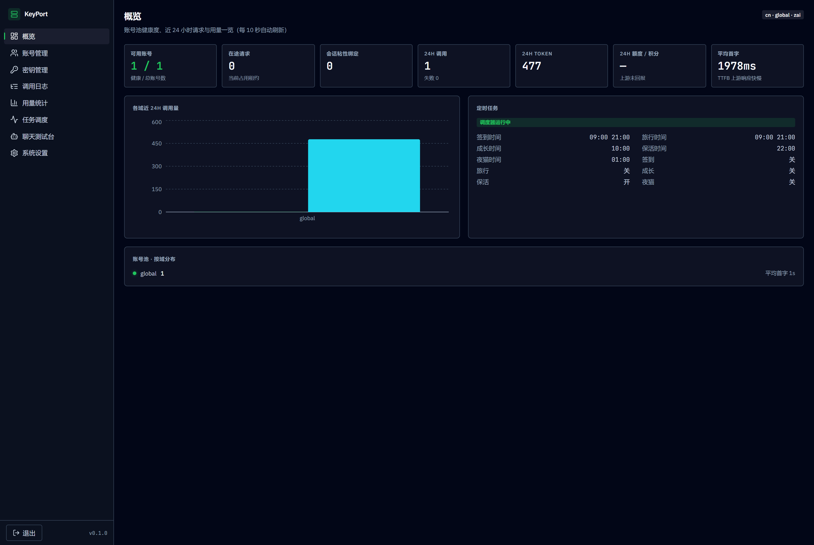
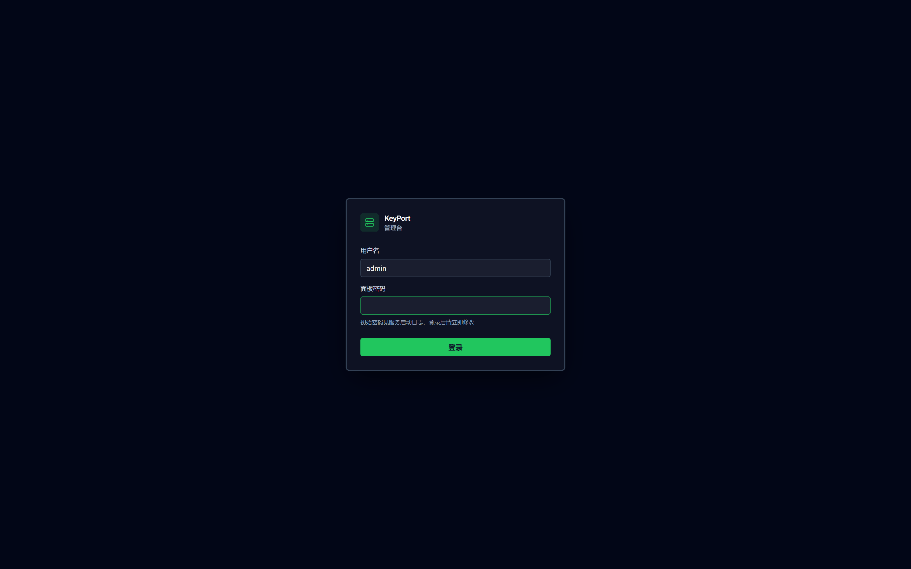
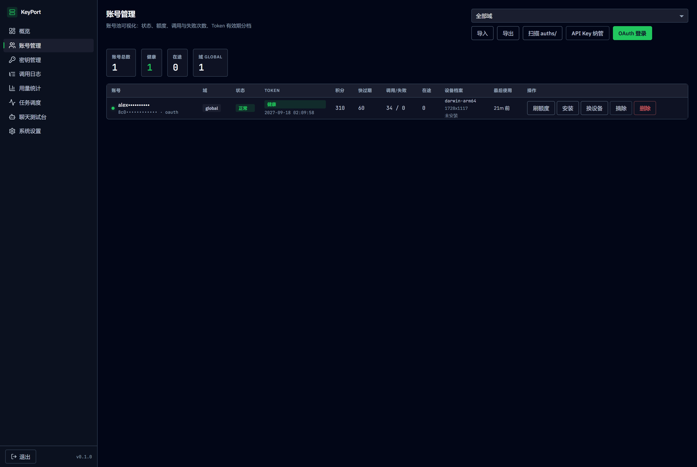
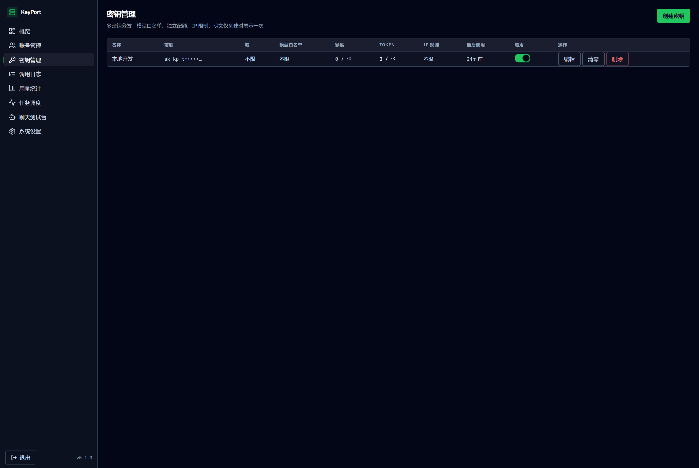
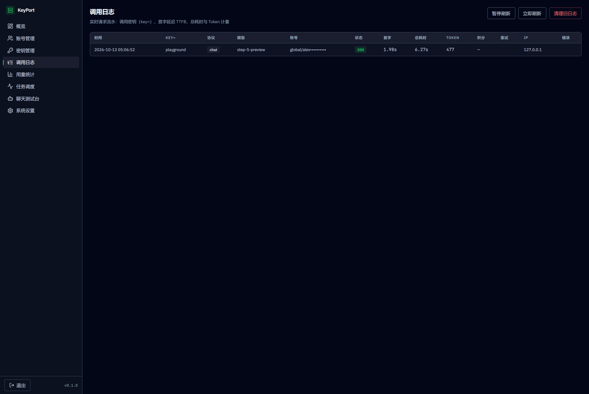
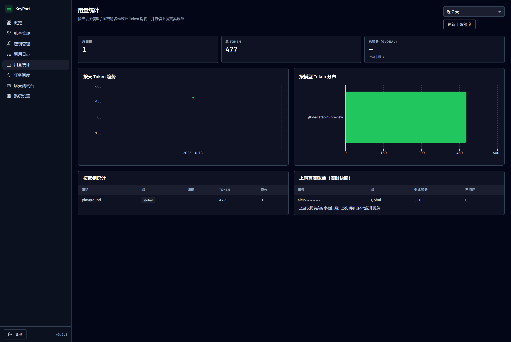
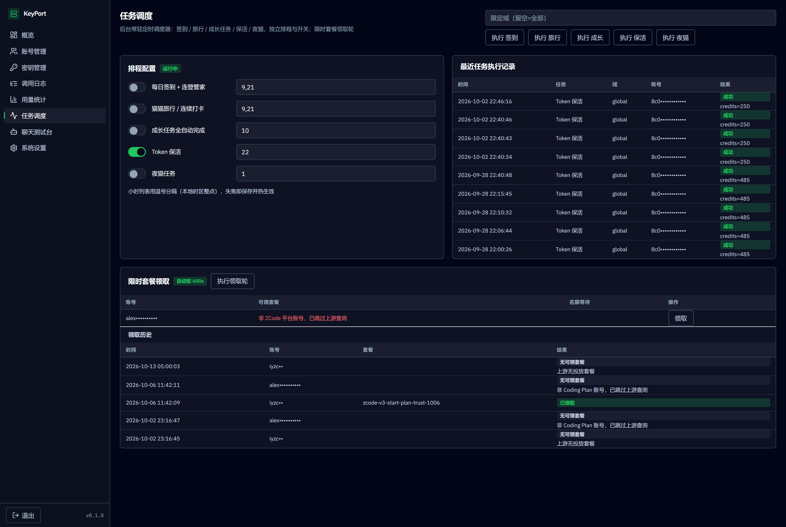
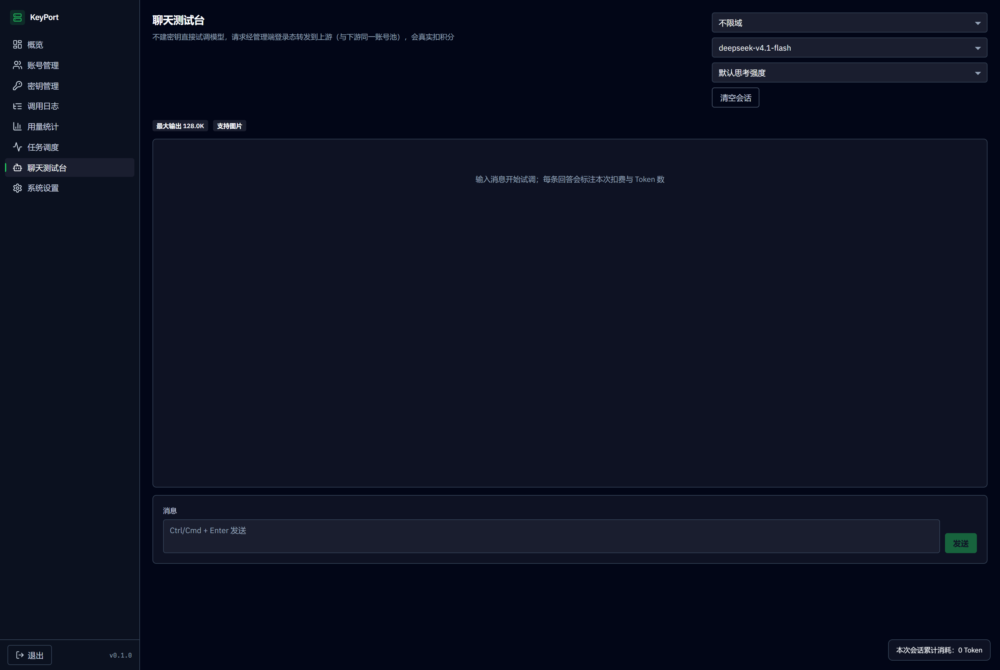
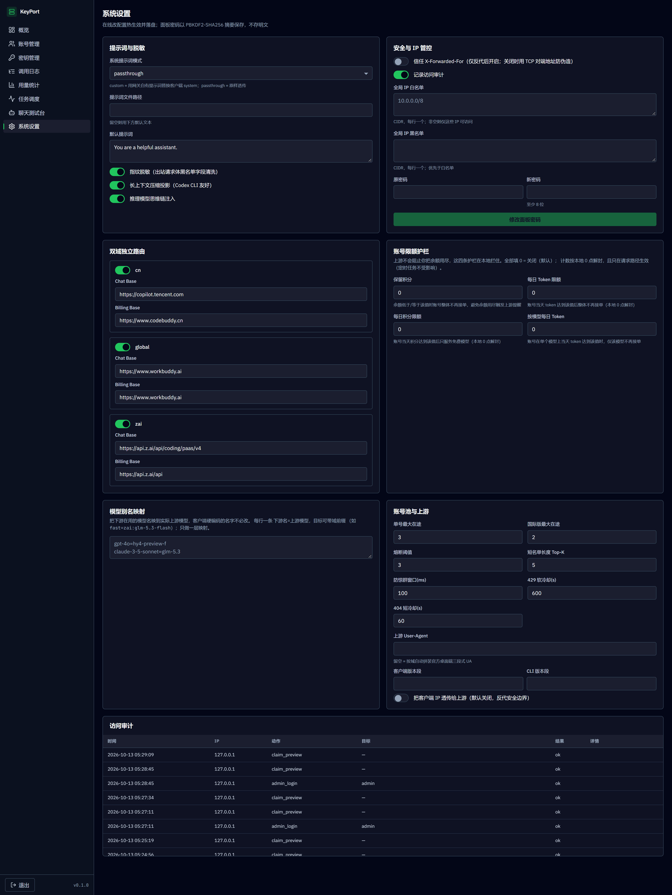

# KeyPort

自托管的多账号 API 反向代理网关：把 **ZCode (z.ai)** 与 **腾讯 CodeBuddy / WorkBuddy** 的账号额度
统一转换为 **OpenAI 兼容 API** 与 **Anthropic Messages API**，并附带一套功能完整的 **Web 管理控制台**。



对外暴露的端点可同时接入：

| 客户端 | 协议 | 端点 |
|---|---|---|
| OpenAI SDK / NextChat / LobeChat | Chat Completions | `POST /v1/chat/completions` |
| Codex CLI | Responses API | `POST /v1/responses` |
| Claude Code CLI / Cline | Anthropic Messages | `POST /v1/messages` |
| 全部 | 模型列表 | `GET /v1/models` |
| 全部 | 密钥自查（不产生上游调用） | `GET /v1/usage` |

运维端点（不消耗密钥额度，供监控与编排使用）：

| 端点 | 鉴权 | 说明 |
|---|---|---|
| `GET /healthz` | 无 | 健康检查：有健康账号返回 `200`，否则 `503`；Docker `HEALTHCHECK` 依赖它 |
| `GET /status` | API Key | 账号池摘要、各账号余额与健康度、成本账本快照 |

> ⚠️ **合规边界**：本项目是非官方网关，使用上游账号作为代理，**仅限本人授权账号、本机 / 私有环境测试**。

---

## 架构

```
下游客户端（Claude Code / OpenAI SDK / Codex CLI / Cline）
        │
        ▼
┌──────────────────────────────────────────────────┐
│  API 网关层：密钥鉴权 · 协议路由 · IP 管控 · 审计 · 用量落库 │
├──────────────────────────────────────────────────┤
│  Web 管理控制台：账号 · 密钥 · 任务 · 监控 · 测试台 · 设置   │
├──────────────────────────────────────────────────┤
│  账号池调度：三因子加权选号 · 熔断冷却 · 会话粘性 · 故障转移   │
├──────────────────────────────────────────────────┤
│  上游适配层：CodeBuddy 适配器 · ZCode(z.ai) 适配器 · 双域隔离 │
└──────────────────────────────────────────────────┘
        │
        ▼
  copilot.tencent.com / www.codebuddy.cn / www.workbuddy.ai / api.z.ai
```

**单进程单端口部署**：前端由 Next.js 静态导出，交由 FastAPI 托管，`/api` 与 `/v1` 同源，无需 CORS。

---

## 快速开始

### 方式一：本地运行

```bash
# 1. 安装依赖（Python 3.11+）
python -m venv .venv && source .venv/bin/activate   # Windows: .venv\Scripts\activate
pip install -r requirements.txt

# 2. 构建管理台（前端静态导出到 frontend/out）
cd frontend && npm install && npm run build && cd ..

# 3. 准备配置
cp config.example.json config.json

# 4. 启动（首次启动会在日志里打印随机面板初始密码）
python -m keyport                      # 等价于 keyport
```

启动参数：

```bash
python -m keyport -c /path/to/config.json   # 指定配置文件（默认 ./config.json）
python -m keyport --host 127.0.0.1 --port 8790   # 覆盖监听地址与端口
python -m keyport --reload                  # 开发模式自动重载
python -m keyport --log-level debug
```

打开 `http://localhost:8790`，用启动日志里的初始密码登录，**登录后请立即修改密码**。

启动后可用健康检查确认就绪（有健康账号才返回 200）：

```bash
curl -fsS http://localhost:8790/healthz
```

#### 可选依赖

| 依赖 | 用途 | 不装的影响 |
|---|---|---|
| `playwright` + Chromium | z.ai Coding Plan 端点的人机验证参数求解 | `zai` 域不可用；`workbuddy国内版` / `workbuddy国际版` 不受影响 |

```bash
pip install playwright && playwright install chromium
```

无头求解的 Chrome 路径可用 `captcha.chrome_path` 指定（留空则用 Playwright 自带 Chromium）。

### 方式二：Docker Compose

```bash
cp config.example.json config.json
docker compose up -d --build

# 查看首次启动生成的面板初始密码
docker compose logs keyport | grep 面板初始密码
```

### 添加账号

**OAuth 设备授权（推荐，免本地桌面客户端）**

```bash
./login.sh                  # 国内版
./login.sh --realm=global   # 国际版
```

脚本会打印授权链接 → 你在浏览器完成登录 → 回车 → 凭证落盘到 `auths/workbuddy/zai-<uid>.json`。
之后在管理台「账号管理」点 **扫描 auths/** 即可纳管（无需重启）；重复执行可连续添加多账号。

**管理台内 OAuth 一键登录**：账号管理页 → 「OAuth 登录」→ 选域(workbuddy/zai) → 打开链接 → 「我已登录」，自动入库。

**API Key 纳管**（z.ai / 兼容 OpenAI 的第三方端点）：账号管理页 → 「API Key 纳管」。

### 导入 / 导出账号凭证

管理台「账号管理」页提供：

- **导出**：一键下载 `keyport-accounts-YYYY-MM-DD.json`，含 `accessToken` / `refreshToken` /
  `deviceToken` / `realm` / `kind`，用于备份或迁移到另一台机器。
- **导入**：粘贴凭证内容或选择文件。支持四种形态：

```jsonc
// 1. ZCode 客户端 / zcode-pool 导出的账号包（format=zcode-accounts-bundle）
{ "format": "zcode-accounts-bundle", "version": 2,
  "accounts": [ { "name": "…", "credentials": { "zcodejwttoken": "…",
                  "oauth:zai:access_token": "…", "oauth:zai:user_info": "…" },
                  "virtualDeviceMid": "…", "config": { "provider": { … } } } ] }

// 2. 本网关导出文件原文（含 accounts 包裹层）
{ "version": 1, "accounts": [ { "auth": {...}, "account": {...} } ] }

// 3. 单条凭证（嵌套形，与 auths/workbuddy/zai-<uid>.json 一致）
{ "auth": { "accessToken": "...", "refreshToken": "..." },
  "account": { "uid": "...", "nickname": "..." } }

// 4. 每行一个 JSON（JSONL），或用扁平形：{"accessToken":"...","uid":"..."}
```

**ZCode 账号包**会自动映射为可用的上游账号：

| 账号包字段 | 映射结果 |
|---|---|
| `zcodejwttoken`（Coding Plan JWT） | API Key，直接作 `Authorization: Bearer` |
| `config.provider` 中启用的 anthropic 条目 | 上游 `baseURL`（如 `https://zcode.z.ai/api/v1/zcode-plan/anthropic`） |
| `virtualDeviceMid` | `X-Device-Mid` 头（服务端按「账号+设备」算额度，缺了额度会查成空） |
| `oauth:<provider>:user_info` 的 `id` / `displayName` | 账号 uid / 昵称 |
| — | `protocol=anthropic`：网关按 Anthropic Messages 原生协议出站，再把响应转回 OpenAI / Responses |

令牌优先级：provider 显式 `apiKey` > `zcodejwttoken` > `oauth:<provider>:access_token`，
且 `baseURL` 始终与最终采用的令牌配套（避免把平台令牌发到 Coding Plan 端点）。

导入结果逐条回报：成功数量、失败数量与**每条失败原因**（缺 `accessToken` / JSON 非法 / 落盘失败等）。
导入的凭证同时写入 `auths/workbuddy-<uid>.json`，与 `login.sh` 产物完全互通。

> `kind` 字段区分 `oauth` 与 `apikey`：导入导出都会保留，API Key 账号不会在迁移后退化成
> OAuth 账号（否则网关会去调 refresh 端点并失败）。

---

## 客户端接入

先在管理台「密钥管理」创建一个 API Key（**明文仅创建时展示一次**），然后：

> 请先用 `GET /v1/models` 查询当前账号实际可用的模型
> （各域目录由上游下发，会随时间变化；也可在管理台「聊天测试台」直接选取）。

```bash
# OpenAI SDK / Chat Completions
curl http://localhost:8790/v1/chat/completions \
  -H "Authorization: Bearer sk-kp-xxxx" -H "Content-Type: application/json" \
  -d '{"model":"deepseek-v4.1-flash","messages":[{"role":"user","content":"你好"}]}'

# Anthropic Messages（Claude Code）
curl http://localhost:8790/v1/messages \
  -H "x-api-key: sk-kp-xxxx" -H "anthropic-version: 2023-06-01" \
  -H "Content-Type: application/json" \
  -d '{"model":"deepseek-v4.1-flash","max_tokens":1024,"messages":[{"role":"user","content":"你好"}]}'

# Codex CLI（Responses API）
curl http://localhost:8790/v1/responses \
  -H "Authorization: Bearer sk-kp-xxxx" -H "Content-Type: application/json" \
  -d '{"model":"deepseek-v4.1-flash","input":"你好"}'
```

### Claude Code 配置

```bash
export ANTHROPIC_BASE_URL=http://localhost:8790
export ANTHROPIC_API_KEY=sk-kp-xxxx
```

### Codex CLI 配置（`~/.codex/config.toml`）

```toml
model = "deepseek-v4.1-flash"
model_provider = "keyport"

[model_providers.keyport]
name = "KeyPort"
base_url = "http://localhost:8790/v1"
env_key = "KEYPORT_API_KEY"
wire_api = "responses"
```

### 双域独立路由

模型名加域前缀即可强制路由到指定域（严格隔离串号）：

```
cn:hy4-preview-f              → 强制国内版 CodeBuddy
global:deepseek-v4.1-flash    → 强制国际版 WorkBuddy
zai:glm-5.3-flash             → 强制 z.ai（GLM Coding Plan）
```

密钥本身也可绑定域（`realm` 字段），越界模型在选号前被拒。

> 未加域前缀时，网关会按「模型归属域」自动路由：模型只在一个域提供时限定该域选号
> （由 `pool.route_by_model` 控制，默认开启）；跨域重名或目录未命中时保持「不限域」。

---

## 核心能力

### 账号池调度

- **三因子加权选号**：`credits 比例 ×10 + 快过期积分占比 ×8 + 闲置补偿`，按权重降序取 Top-5 短名单，再在短名单内加权抽签；等权重候选随机打乱防饿死。
- **防惊群**：跳过 100ms 内刚被选中的账号；短名单全部刚用过时用 LRU 兜底。
- **在途租约**：单账号最大在途请求数限制（国内版 / 国际版可分别配置），占满的号不参与选号。
- **熔断与冷却**：429 软冷却 600s 起指数退避封顶 2h；404 固定 60s；402 硬冷却至次日 04:00；连续失败达阈值触发熔断（指数退避封顶 6h）；401/403 系统级禁用。
- **模型级限流独立冷却**：6004（该模型用量超限）只冷却触发调用的模型，切其他模型立即可用。
- **会话粘性**：同一会话绑定同一账号，TTL 滚动续期，失败自动解绑；可选 Redis 镜像防重启丢失。
- **故障转移**：额度用完 / 限流 / 鉴权失效自动换下一个可用账号，最多重试 N 次。
- **账本择优**：按 `(域, 模型)` 记录每千 token 实测单价，EMA 平滑、6 小时未更新即失效，免费 / 便宜的账号优先。
- **状态持久化**：冷却 / 熔断 / 额度 / 账本 / 设备档案落盘 `data/state.json`，重启不丢。

### 分级错误处置（与账号状态严格对应）

不同错误对账号的伤害程度完全不同，混为一谈会把健康账号误杀：

| 上游信号 | 处置 | 账号状态 |
|---|---|---|
| **429 频控** | **不冷却**，按 `Retry-After`（封顶 120s）原地等待重试；耗尽后换号 | 保持可用，不计连败 |
| **429 + 1113**（Key 无资源包） | 永久态，**不等待**，直接切回退通道 / 换号 | 保持可用 |
| **验证码 3007** | 同账号换码重试（≤3 次），被拒的码立即出池 | 不冷却不熔断不计连败 |
| **5xx / 连接失败** | 原地重试（≤3 次），耗尽后冷却 300s 换号 | `cooling` |
| **风控 3012 / 405** | 指数退避 900s 起封顶 24h，**不原地重试** | `cooling`，累计 4 次升级禁用 |
| **401 / 403 鉴权** | 立即换号；有回退 Key 时先切回退 | 禁用（需重新授权） |
| **402 / 额度耗尽** | 硬冷却至次日 04:00 | 禁用（额度恢复自动复活） |

**429 与 5xx 的关键差异**：429 是频控、账号本身健康，冷却它等于把可用产能踢出池；
5xx 才是账号侧故障。风控同理不原地重试 —— 对已被标记的账号持续施压只会加剧风控。

### 风控隔离与「换设备重生」

上游 `3012 unusual activity` 实测是**频道级瞬时频控**（同号同刻 billing 正常、数小时自愈），
所以默认策略是**指数退避自动恢复**而非直接禁用 —— 硬禁用会让健康的签到 / 领取链路陪葬。

- 退避基数 `risk_cooldown_seconds`（默认 900s），逐次翻倍，封顶 `risk_cooldown_max_seconds`（24h）。
- 窗口内累计 `risk_ban_strikes`（默认 4）次才升级禁用，需后台人工确认恢复；`risk_strike_decay_seconds`
  之外的命中重新起算，避免跨月偶发命中累积成禁用。
- `risk_auto_rotate`（默认开）：升级禁用时**自动换发全新设备档案**（新 SKU + 新 `device_mid`）
  并补跑安装序 —— 账号重新启用时已是全新身份。
- **风控禁用绝不因额度数字复活**：只有额度耗尽（`quota_exhausted`）才走自动复活。

### API Key 回退通道

ZCode 账号包同时含 Coding Plan JWT 与平台令牌时，网关会把后者登记为**同账号的回退通道**
（`api.z.ai/api/anthropic`，免验证码、不吃 Plan 额度）：

- Plan 通道 429 重试耗尽 / 鉴权失效 / 命中风控 → 自动切回退通道继续服务。
- 回退是**请求级**路由决策，**不改账号状态**（Plan 通道 429 时账号仍是健康的）。
- 回退通道成功**不会**洗掉风控计数与禁用状态 —— Plan 通道尚未解除，洗掉会立刻重打。

### 账号级限额护栏

上游只告诉你「余额还剩多少」，**不会**阻止你把余额用尽。四条护栏在本地拦住
会把账号烧穿的请求（默认全关 = `0`，装上护栏前的老部署行为逐字不变）：

| 护栏 | 触发后行为 | 防的是什么 |
|---|---|---|
| `reserve_credits` | 账号整体不再接单 | 余额被用尽后触发上游的提醒 / 风控 |
| `daily_token_limit` | 账号整体不再接单 | 单账号一天吃掉过多 token |
| `daily_credit_limit` | 账号**只服务免费模型** | 付费模型把当天积分额度烧光 |
| `model_daily_token_limit` | 该账号**仅该模型**不再接单 | 单账号单模型撞上游 24h 窗口配额 |

三条不可动摇的语义：

- **计数未知时绝不停用**。用量读不出来（DB 异常）时计数保持 `None`，护栏**放行** ——
  宁可放过一次请求，也不能因为读不到数据把整个账号池判死。
- **按本地 0 点解封**，且只在**请求路径**生效：定时任务（签到 / 保活 / 领取）
  不受影响 —— 它们不消耗对话额度，被挡住只会白白丢功能。
- **被护栏挡住 ≠ 失败**：只跳过、换下一个账号，不落冷却、不计连败。

免费 / 付费的判据是**各域自己的模型目录**（成本账本 tier 0 = 免费）；账本未观测过的
模型按付费处理 —— 「不确定是否免费」不该被当成免费放行。支持分域覆盖
（`guards.realm_overrides`，某键缺省即继承全局）。

### 模型别名映射

把下游在用的模型名映到实际上游模型，客户端硬编码的名字不必改：

```jsonc
"models": { "aliases": { "gpt-4o": "hy4-preview-f", "fast": "zai:glm-5.3-flash" } }
```

别名键大小写不敏感，目标可带域前缀（映射发生在解析域前缀**之前**）；
只做**一层**映射（别名指向别名时不再二次解析，避免环与歧义）。
管理台「系统设置」页按 `下游名=上游模型` 逐行编辑。

### 密钥自查（`GET /v1/usage`）

下游可用它做预算告警，**只读本地记账、不产生任何上游调用**：

```bash
curl http://localhost:8790/v1/usage -H "Authorization: Bearer sk-kp-xxxx"
# → { "tokens": {"quota":1000,"used":250,"remaining":750,"exhausted":false}, ... }
```

`quota=0`（不限）时 `remaining` 为 `null` —— 不编造数字。配额真用尽时该端点与其余
`/v1` 端点一致返回 `429`（文案已说明原因），不为它开绕过配额门的口子。

### 出站请求改写管线

强制 `stream:true` → `max_completion_tokens` 翻译 → 补 `stream_options.include_usage` →
`tool_choice` 归一化（上游只认 string）→ `developer` 角色归一为 `system` →
tool 配对重排 + 孤儿清理 → DeepSeek 思维链注入 + effort 档位降级 + `reasoning_content` 回填 →
指纹脱敏（可关闭）→ 系统提示词替换（`custom` / `passthrough` / `append`）。

### 自动化任务(CodeBuddy/WorkBuddy)

后台常驻定时调度器，五类任务独立排程与开关（管理台可热改并落盘）：

| 任务 | 默认时间 | 说明 |
|---|---|---|
| 签到 + 连登管家 | 09:00 / 21:00 | 签到后自动兑换已解锁档位、抽完抽奖次数 |
| 猫猫旅行 / 连续打卡 | 09:00 / 21:00 | 独立排程 |
| 成长任务全自动完成 | 10:00 | 接取任务 → 行为事件上报点亮 → 自动领奖 |
| Token 保活 | 22:00 | WorkBuddy国际版自适应为专属 Token 集中保活 |
| 夜猫任务 | 01:00 | 独立排程 |

### 每账号设备档案（一号一台设备）

网关跑在 Linux 云主机上，若把 N 个账号都标成同一套「云内核 + 1920x1080」，
会在上游聚成「一台机房机器开了 N 个账号」的强关联信号。故入池时为每个账号
分配**成套桌面 SKU 档案**：

- 从成套 SKU 表抽样（`platform × arch × os_version × screen` **绑定**），禁止字段
  笛卡尔积产生的假电脑（如 `darwin-arm64 + 1366x768`）。
- 账号池**不含 linux**：官方桌面端主形态是 Mac / Windows。
- 语言 / 时区取真实地区对（不允许 `de-DE + Asia/Tokyo`）。
- `device_mid` 每次全新 UUIDv4，跨账号不复用；同一账号一经分配即稳定。
- 出站身份头（`X-Platform` / `X-Os-*` / `X-Client-*` / `X-Device-Mid`）与激活事件
  全部按该档案出值 —— messages 通道与 billing 通道**同源跟随**，不留矛盾信号。
- 未落库的账号按 uid **稳定派生**档案（`profile_for`），保证在持久化之前也不会
  每次请求换设备。
- 后台可「换发设备」（新 SKU + 新 `device_mid`），风控升级禁用时自动触发。

### 官方首启安装序仿真

> **仅对 ZCode 平台账号执行**（`realm=zai` 且 base_url 指向 Coding Plan 网关）。
> 安装序与激活上报模拟的是 ZCode 桌面端首启行为，对 WorkBuddy / CodeBuddy 账号
> 执行等于伪造无关信号 —— 那两类账号加入时整体跳过，**零上游请求**。

按官方桌面端真实首启顺序请求一遍，让账号在指纹层与官方客户端不可区分：

1. `GET /api/v1/client/configs?app_version=…` —— 免鉴权拉取运行配置
   （验证码开关、活动套餐投放开关）。实测带 `platform` 参数会被拒（3001），故只带 `app_version`。
2. `POST /api/v1/event/report` —— 激活遥测（**无 Authorization**），
   `element = app_launch → app_daily_active`，日活去重由上游按 `device_mid` + 日期计算。

安装先于登录：未登录设备同样上报 `app_launch`（`user_id` 为空串），登录后才带 `user_id`。
入池 / 指纹换发后自动补跑，`installed_at` 幂等；任何失败只留痕，不影响主服务。

### 限时套餐领取

> **仅对 ZCode 平台账号执行**。套餐领取是 Coding Plan 专属权益，其它域打
> `billing/*` 只会 404 并白耗上游流量。

ZCode Coding Plan 的活动套餐（`billing/preview` → `billing/claim`）双轨领取：

- **自动**：入池即领，另有周期轮（`claim.round_interval_seconds`，默认 600s，0 = 关闭）。
- **手动**：管理台调起阿里云滑块，把浏览器产生的 `verifyParam` 转发给上游。

语义对齐官方口径：成功回执携带上游 `server_time` 与套餐窗口（`starts_at` / `ends_at`）；
`1005 名额用完`附带名额恢复时间 `next_at`，领取轮按其退避 —— **等待期不重试领取、
不耗验证码**，`next_at` 过后自动恢复。

> **激活上报先于 preview**：活动投放疑似以当日激活信号为资格，反序会形成
> 「preview 恒空 → 永不激活 → 也就不会上报」的死锁。每号每天最多成功上报一次。

### 管理台

> 以下截图取自本机实跑实例（`http://127.0.0.1:8790`，`admin` 账号登录）。
> 重新生成：`python scripts/capture_screens.py --password <面板密码>`
> —— 脚本只读页面、不改任何服务端状态，产物落在 `docs/images/`。
>
> **截图默认自动脱敏**：账号 UID / 昵称、密钥前缀会被替换成掩码后再渲染
> （脚本先读出敏感值，再拦截管理 API 响应做替换，前端从头到尾只见过掩码值）。
> `--no-redact` 可关闭，但**产物含真实标识，不要提交进版本库**。

#### 登录



面板密码以 PBKDF2-SHA256（210k 迭代 + 随机盐）摘要保存，**不存明文**；
首次启动会在日志里打印随机初始密码。连续登录失败达上限会锁定来源 IP 5 分钟。

#### 概览（`/`）


账号池健康度（可用 / 总数）、在途请求与**会话粘性绑定**、24h 调用与 Token、
平均首字延迟（TTFB，只统计上游真正吐字的请求）；左侧各域调用量图表，
右侧调度器实时状态（各任务开关与执行时刻），下方按域分布账号池。
每 10 秒自动刷新。

#### 账号管理（`/accounts`）



- 状态四档着色（正常 / 冷却 / 熔断 / 已禁用），Token 有效期另按
  已过期 / 即将过期 / 偏紧 / 健康分档。
- **设备档案列**：显示该账号被分配到的成套桌面 SKU（平台-架构 + 分辨率）
  与安装序状态（已安装 / 未安装）—— 一号一台设备的可视化依据。
- **风控命中次数**（`风控 ×N`）：窗口内累计到阈值会升级禁用。
- 操作：刷额度、**补跑安装序**、**换发设备**（新 SKU + 新 `device_mid`）、
  摘除 / 放回池、恢复、删除。
- 顶部：按域筛选、导入 / 导出、扫描 `auths/`、API Key 纳管、OAuth 登录。

#### 密钥管理（`/keys`）



多密钥分发：每把密钥独立设域、模型白名单、积分与 Token 配额、IP 白 / 黑名单；
创建 / 启停 / 删除即时生效，可对任一密钥**清零**已用量。
明文**仅在创建时展示一次**，服务端只保存 SHA-256 摘要。

#### 调用日志（`/logs`）



逐行标明调用密钥（`key=` 列）、协议、上游模型、状态码、首字延迟（TTFB）、
总耗时、Token 计量、重试次数与来源 IP。TTFB 是「发起上游请求到收到第一个含
正文的 delta」，直接反映上游响应快慢。

#### 用量统计（`/usage`）



按天 / 按模型 / 按密钥多维统计 Token 消耗（支持近 7 / 30 天窗口切换），
并**直读上游真实账单快照**。注意这里并列两种口径：本地逐请求记账（准确、
可归因到密钥）与上游余额快照（只给当前值、不提供历史明细）—— 上游没有历史
明细接口，所以不编造。

#### 任务调度（`/tasks`）



- **排程配置**：签到 / 旅行 / 成长 / 保活 / 夜猫五类任务独立开关与执行时刻，
  逗号分隔的小时列表（本地时区），失焦即保存并热生效。
- **最近任务执行记录**：逐次尝试的结果与详情。
- **限时套餐领取**：可领套餐、名额等待倒计时、领取历史。
  截图里可以看到 **ZCode 平台账号门控**在生效 —— 非 Coding Plan 账号显示
  「非 ZCode 平台账号，已跳过上游查询」，不会去打上游 `billing/*`。

#### 聊天测试台（`/playground`）



不建密钥直接试调模型，可选域 / 模型 / 推理强度，显示思考过程、每次扣费与
Token，右下角累计本次会话消耗。请求经管理端登录态转发（与下游同一账号池），
**会真实扣积分**。

#### 系统设置（`/settings`）



- **提示词与脱敏**：`custom` / `passthrough` / `append` 三种模式、
  指纹脱敏、长上下文压缩、思维链注入。
- **安全与 IP 管控**：全局 IP 白 / 黑名单（CIDR）、审计开关、
  是否信任 `X-Forwarded-For`（默认**不信任**，用 TCP 对端地址防伪造）、面板密码修改。
- **双域独立路由**：cn / global / zai 三域端点各自启停与编辑。
- **账号限额护栏**：四条护栏阈值（保留积分 / 每日 Token / 每日积分 / 按模型每日
  Token），启用后下方会列出各账号当日用量与受限原因。详见
  [账号级限额护栏](#账号级限额护栏)。
- **模型别名映射**：`下游名=上游模型` 逐行编辑，目标可带域前缀。
- **账号池与上游**：在途上限、熔断阈值、短名单长度、防惊群窗口、各类冷却时长、
  上游 UA 指纹、是否把下游 IP 透传给上游。
- **访问审计**：敏感操作留痕（谁、什么时候、做了什么）。

---

## 用量计量与配额

### 两域计量单位不同

上游对「用了多少」的回报方式不一致，直接决定了密钥配额该怎么设：

| 域 | 额度单位 | 上游回报的计量 | 是否随请求扣减 |
|---|---|---|---|
| `zai` | **Token** | `usage.total_tokens`（准确） | 是，精确按 token |
| `global` | **积分** | `usage.credit`（**仅付费模型有值**，免费模型为 `0`） | 是（取整扣减） |
| `cn` | 积分 | `usage.credit` | 是 |

`global` 的模型倍率以 `credits` 字段透出（如 `x0.79 credits`，`x0.00` 即免费模型）。
配置项 `realms.global.models_free_only: true` 会把模型目录**过滤为只剩 0 倍率的免费模型**——
此时用量当然不扣积分，这是预期行为而非故障。

### 密钥配额怎么设（推荐：统一用 Token 配额）

| 字段 | 适用域 | 说明 |
|---|---|---|
| `quota_tokens` | **所有域** | 两域都回报 `total_tokens`，唯一通用可靠的计量。`0` = 不限 |
| `quota_credits` | `cn` / `global` | 按积分精确控量。**在 `zai` 域不生效**（见下） |

**为什么 `quota_credits` 在 `zai` 域是死配置**：z.ai 的 `usage` 不含 `credit` 字段，
网关的 `extract_credits` 因而恒返回 `0`，`used_credits` 永远是 `0`，`credits_exhausted()`
永远为 `False`——设了不会报错，但也不会拦。管理台在选中 `zai` 域时会禁用该输入框并给出提示。

**不限域的密钥请只用 `quota_tokens`**：否则命中 `zai` 账号时，积分配额形同虚设。

配额用尽时返回 `429`（`rate_limit_error`），提示「该密钥积分配额已用尽 / Token 配额已用尽」。
「密钥管理」页可对任一密钥执行**清零**（重置 `used_credits` 与 `used_tokens`）。

### 成本账本

网关按 `(域, 模型)` 记录每次成功请求的**实测单价**（`credits / tokens × 1000`），
EMA 平滑（α=0.3）、6 小时未更新即失效，用于选号时「免费 / 便宜的账号优先」。
`GET /status` 的 `model_costs` 字段可查看当前账本快照。

> 说明：上游只提供「当前余额 / 剩余积分」快照，**不提供历史明细接口**。
> 因此用量统计页给出的是「各账号实时快照 + 本地逐请求记账」的联合视图，不编造历史。

---

## 配置

优先级（低 → 高）：**内置默认 < `config.json` < 环境变量 `KP_*`**。

环境变量用双下划线表示层级：

```bash
KP_LISTEN_PORT=8790
KP_SECURITY__TRUST_PROXY_HEADERS=true
KP_POOL__MAX_IN_FLIGHT=5
KP_CONFIG_FILE=/app/data/config.json     # 配置文件位置（容器里推荐放持久化卷）
```

管理台改的配置会写回配置文件并**热生效**（无需重启）。

### 配置段总览

完整字段见 `config.example.json`。以下为各段要点（默认值以代码为准）：

| 段 | 关键字段 | 说明 |
|---|---|---|
| 顶层 | `listen_host` / `listen_port` | 监听地址与端口（默认 `0.0.0.0:8790`） |
| | `data_dir` / `auth_dir` | SQLite 与凭证目录（默认 `./data` / `./auths`） |
| | `static_dir` | 前端产物目录，留空则用 `frontend/out` |
| | `public_base_url` | 对外基址（OAuth 回跳用） |
| `upstream` | `timeout_seconds` / `idle_timeout_seconds` | 请求超时与流空闲超时 |
| | `user_agent` / `client_version` / `cli_version` / `client_name` | 出站 UA 指纹，留空用内置默认 |
| | `passthrough_ip` | 是否把下游 IP 透传给上游 |
| `captcha` | `enabled` / `headless` / `pool_size` | z.ai 人机验证参数农场（见下） |
| | `chrome_path` / `scene_id` / `prefix` / `region` | 浏览器路径与场景参数，留空自动探测 |
| `pool` | `max_in_flight` / `max_in_flight_global` | 单账号最大在途请求（按域分别配置） |
| | `breaker_threshold` / `breaker_cooldown_*` | 熔断阈值与指数退避区间 |
| | `soft_rate_seconds` / `not_found_seconds` | 429 软冷却基数、404 冷却时长 |
| | `retry_429_times` / `retry_429_wait` / `retry_429_wait_max` | 429 原地重试次数与等待（采信上游 Retry-After，封顶防吊死） |
| | `retry_5xx_times` / `retry_5xx_wait` / `cooling_seconds` | 5xx 重试与冷却 |
| | `risk_cooldown_*` / `risk_ban_strikes` / `risk_strike_decay_seconds` | 风控指数退避、升级禁用阈值、strikes 衰减窗口 |
| | `risk_auto_rotate` | 风控升级禁用时自动换发设备档案 |
| | `top_k` / `pick_gap_ms` | 选号短名单大小、防惊群间隔 |
| `claim` | `enabled` / `round_interval_seconds` | 限时套餐领取开关与自动轮间隔（0 = 关闭轮） |
| | `auto_on_add` / `cooldown_seconds` / `max_accounts_per_round` | 入池即领、失败退避、单轮账号上限 |
| `install` | `enabled` / `auto_on_add` / `timeout_seconds` | 官方首启安装序仿真 |
| `guards` | `reserve_credits` / `daily_token_limit` | 账号级护栏（0 = 关闭；见「账号级限额护栏」） |
| | `daily_credit_limit` / `model_daily_token_limit` | 付费模型限流、单模型限流 |
| | `realm_overrides` | 分域覆盖（缺省 / null = 继承全局） |
| `models` | `aliases` | 模型别名映射（见「模型别名映射」） |
| `session_sticky` | `enabled` / `ttl_seconds` / `redis_url` | 会话粘性；填 `redis_url` 可跨重启保留绑定 |
| `schedule` | `*_hours` / `*_enabled` | 五类定时任务的时间与开关（见「自动化任务」） |
| `prompt` | `mode` / `file` / `default_text` | 提示词策略：`custom`（替换）/ `append`（追加）/ `passthrough`（透传） |
| `features` | `sanitize_blacklist_fingerprints` | 指纹脱敏（关闭可能触发上游风控） |
| | `compress_long_context` / `reasoning_injection` | 长上下文压缩、思维链注入 |
| `security` | `admin_password_hash` | 面板密码摘要，留空则首次启动生成随机密码 |
| | `session_ttl_seconds` / `audit_enabled` | 会话有效期、审计开关 |
| | `global_allowlist` / `global_blocklist` | 全局 IP 白 / 黑名单（CIDR） |
| `realms` | `enabled` / `chat_base` / `billing_base` / `models_base` | 各域端点（`CodeBuddy` / `WorkBuddy` / `zai`） |
| | `models_free_only` | 仅列出 0 倍率免费模型（`WorkBuddy` 默认开启） |

### 人机验证（`captcha`）

z.ai Coding Plan 网关要求每个请求携带阿里云无痕验证参数，缺失即返回
`400 {"code":3007,"msg":"captcha verify failed"}`。网关内置一个常驻求解农场：
按需补货（队列低于 `pool_size` 才求解）、失败退避、异常自愈重启。

- 需要 `playwright` 与 Chromium；未安装时仅 `zai` 域不可用，`CodeBuddy` / `WorkBuddy` 不受影响。
- `enabled: false` 可整体关闭（关闭后 `zai` 域请求会因缺参数失败）。
- 求解器内建于 `keyport/upstream/captcha.py`：Playwright 驱动本机 Chrome/Edge
  （未配置 `chrome_path` 时自动探测），无需 Node.js 依赖。
  UA 版本号刻意固定、不跟随本机 Chrome，避免触发上游 F011 风控。

### 反代部署注意事项

默认 **不信任** `X-Forwarded-For`（用 TCP 对端地址做 IP 管控，防伪造绕过）。
只有在反向代理后面、且确信只有你的反代能直连本服务时，才开启：

```bash
KP_SECURITY__TRUST_PROXY_HEADERS=true
```

---

## 开发

```bash
# 后端测试
python -m pytest tests -q

# 代码检查
python -m ruff check keyport tests

# 部署冒烟：真实起 uvicorn，验证静态托管 / 鉴权 / 健康检查
python scripts/serve_smoke.py

# 其余流程脚本（均为真实 uvicorn + 假上游，不消耗真实额度）
python scripts/smoke.py        # 配置 / 数据库 / 安全原语可导入可用
python scripts/e2e_flow.py     # 登录 → 建密钥 → 三种协议调用
python scripts/io_flow.py      # 账号导入导出
python scripts/zai_flow.py     # z.ai 账号包导入 → Anthropic 端点全链路

# 管理台截图（需服务已在跑；只读页面，不改服务端状态）
# 依赖 playwright：pip install playwright
python scripts/capture_screens.py --password <面板密码>            # → docs/images/
python scripts/capture_screens.py --base http://127.0.0.1:8790 --out docs/images

# 前端
cd frontend
npm run dev          # 开发模式（:3000）
npm run build        # 构建静态导出到 frontend/out
npm run typecheck    # tsc --noEmit
npm run lint
```

### 目录结构

```
keyport/
├── api/            # 网关与管理台路由、鉴权中间件、日志、调度器胶水
│   ├── routes_v1.py        # /v1/* 三协议入口 + 鉴权/配额/IP 校验
│   ├── routes_admin.py     # 账号管理、OAuth、设备档案、领取、导入导出、概览
│   ├── routes_keys.py      # API Key 增删改查、配额、IP 规则
│   ├── routes_ops.py       # 日志、用量、账单、任务、设置、测试台
│   ├── gateway.py          # 会话生命周期、分级错误处置、选号重试、用量落库
│   ├── auth_middleware.py  # KeyContext：模型白名单 / 配额 / IP 判定
│   └── models.py           # 模型目录缓存与「归属域」路由
├── auth/           # OAuth 设备授权 + z.ai CLI OAuth、凭证文件读写、token 刷新
├── pool/           # 账号池：选号、冷却状态机、风控退避、限额护栏、会话粘性、成本账本
│   └── guards.py           # 账号级限额护栏（保留积分 / 日 Token / 日积分 / 按模型）
├── protocol/       # Anthropic Messages ↔ OpenAI、Responses ↔ OpenAI 转换
├── upstream/       # 出站头构造、请求体改写、SSE 引擎、上游 HTTP 客户端
│   ├── constants.py        # 上游常量收口（URL / 版本 / 关键字 / 模型名）
│   ├── fingerprint.py      # 每账号成套桌面 SKU 设备档案（一号一台）
│   ├── hostinfo.py         # 宿主机真实指纹采集（诊断用，非入池源）
│   ├── claim.py            # 限时套餐领取（preview / claim / 后台轮）
│   ├── install.py          # 官方首启安装序仿真
│   ├── telemetry.py        # 激活遥测上报（官方 event/report 单一事实源）
│   └── assets/             # ZCode 官方 system prompt 静态文案
├── config.py       # 配置加载与热改落盘
├── db.py           # SQLite 持久层
├── security.py     # PBKDF2 / API Key 哈希 / CIDR / 会话令牌
├── scheduler.py    # 后台常驻定时调度器
└── app.py          # FastAPI 装配与静态托管
frontend/           # Next.js 15 + React 19 + Tailwind + recharts 管理台
scripts/            # 冒烟与端到端流程脚本（serve_smoke / e2e_flow / io_flow / zai_flow）
tests/              # 单元与端到端测试（pytest，asyncio_mode=auto）
```

依赖清单位于两处：`requirements.txt`（运行时）与 `pyproject.toml`（打包 / 开发依赖 `dev` extra）。

---

## 安全说明

- 面板密码以 **PBKDF2-SHA256**（210k 迭代 + 随机盐）摘要保存，**不存明文**；首次启动生成随机密码并打印一次。
- API Key 明文**仅在创建时展示一次**，服务端只保存 SHA-256 摘要；列表只暴露前缀。
- 比对一律使用 `hmac.compare_digest` 防时序侧信道。
- 管理台会话令牌服务端随机生成，落库只存摘要，过期自动清理。
- 数据与凭证目录已在 `.gitignore` / `.dockerignore` 中排除，**不会进镜像或版本库**。

## 许可证

仅供技术交流与学习。请遵守上游服务条款与所在地法律法规，使用风险自负。
